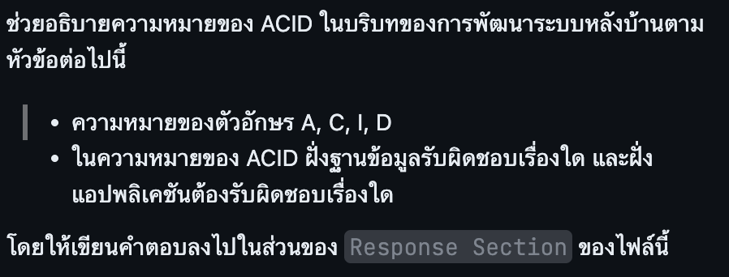

## Question

## Response Section
ACID คือคุณสมบัติสำคัญของระบบจัดการฐานข้อมูล (RDBMS) ที่ช่วยรับประกันความถูกต้องและความน่าเชื่อถือของการประมวลผลข้อมูลในรูปแบบ Transaction (ชุดคำสั่งที่ต้องทำงานร่วมกัน)

---

### 1. ความหมายของตัวอักษร A, C, I, D

* **A - Atomicity (ความเป็นหนึ่งเดียว):** ทุกขั้นตอนใน Transaction ต้องทำงานสำเร็จทั้งหมด หากมีขั้นตอนใดล้มเหลว ระบบจะยกเลิกและย้อนกลับ (Rollback) ข้อมูลทั้งหมดเหมือนไม่เคยเกิดขึ้น (*All or Nothing*)
* **C - Consistency (ความถูกต้องตามกฎเกณฑ์):** ข้อมูลก่อนและหลังการทำ Transaction ต้องถูกต้องและเป็นไปตามกฎเกณฑ์ (Constraints/Rules) ที่กำหนดไว้เสมอ
* **I - Isolation (ความเป็นเอกเทศ):** การทำงานของ Transaction หลายรายการพร้อมกัน ต้องไม่รบกวนกันจนข้อมูลผิดพลาด โดยระดับการแยกกันขึ้นกับ Isolation Level ที่เลือกใช้ และที่ระดับสูงสุด (Serializable) ผลลัพธ์จะเสมือนกับการทำงานทีละรายการตามลำดับ
* **D - Durability (ความคงทนถาวร):** เมื่อ Transaction ทำงานเสร็จสมบูรณ์ (Commit) แล้ว ข้อมูลจะถูกบันทึกไว้อย่างถาวร แม้ระบบจะเกิด Crash หรือไฟดับในภายหลัง ข้อมูลก็จะไม่สูญหาย

---

### 2. ความรับผิดชอบระหว่างฝั่ง Database และ ฝั่ง Application

ในการพัฒนาระบบหลังบ้าน ทั้งฝั่งฐานข้อมูลและแอปพลิเคชันต้องร่วมมือกันเพื่อให้ระบบมีคุณสมบัติ ACID อย่างสมบูรณ์:

| ฝั่งระบบ | หน้าที่และความรับผิดชอบตามหลัก ACID |
| :--- | :--- |
| **Database (DB)** | • **Atomicity:** จัดการระบบ Transaction, Transaction Logs และ Undo Logs เพื่อทำ Rollback เมื่อเกิดข้อผิดพลาด • **Consistency:** บังคับใช้ Database Constraints (เช่น `NOT NULL`, `UNIQUE`, `FOREIGN KEY`, `CHECK`) บน Schemas • **Isolation:** จัดการระบบ Lock (Concurrency Control) และ Isolation Levels เพื่อป้องกันปัญหาข้อมูลขัดกัน (Race Conditions) • **Durability:** บันทึกข้อมูลลงใน Non-volatile Storage และใช้ Redo Logs / Write-Ahead Logging (WAL) สำหรับกู้คืนข้อมูลเมื่อระบบขัดข้อง |
| **Application (Backend)** | • **Atomicity:** กำหนดขอบเขตของ Transaction (`BEGIN`, `COMMIT`, `ROLLBACK`) และออกแบบ Workflow ให้ครอบคลุมทุก Operation ที่ต้องทำร่วมกัน • **Consistency:** ตรวจสอบและบังคับใช้ Business Rules ที่ Database Constraints ครอบคลุมได้ยาก เช่น ยอดเงินที่โอนออกต้องเท่ากับยอดที่โอนเข้า หรือสถานะคำสั่งซื้อต้องเปลี่ยนตามลำดับที่กำหนด • **Isolation:** เลือกปรับระดับ Isolation Level ให้เหมาะสมกับลักษณะงาน และจัดการ Retry Logic เมื่อเกิด Deadlock หรือ Concurrency Conflict • **Durability:** ตอบ Success กลับไปยัง Client หลังจาก `COMMIT` สำเร็จแล้วเท่านั้น และออกแบบ Architecture เพื่อรองรับการทำงาน เช่น การทำ Database Replication, Multi-node Failover และการจัดการ Event Queue ไม่ให้ข้อมูลสูญหายก่อนลง DB |