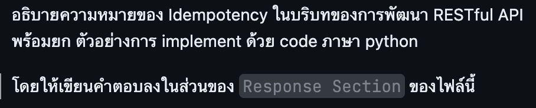

## Question

## Response Section
**Idempotency** คือคุณสมบัติของ API ที่แม้นจะถูกเรียกใช้งานด้วย **Request เดิม (Input เหมือนเดิม) ซ้ำกันหลายๆ ครั้ง** ผลลัพธ์ที่เกิดขึ้นบนเซิร์ฟเวอร์ (State/Data) จะยังคงเหมือนกับการเรียกใช้งานเพียง **ครั้งเดียว** เสมอ โดยไม่ทำให้เกิด Side Effect หรือข้อมูลผิดพลาดเพิ่มเติมจากการส่งซ้ำ

---

### 1. พฤติกรรมตาม HTTP Methods

* **Idempotent Methods:**
  * `GET`: การดึงข้อมูลซ้ำกี่ครั้ง ข้อมูลบน Server ก็ไม่มีการเปลี่ยนแปลง
  * `PUT`: การอัปเดตข้อมูลทั้งก้อนด้วยข้อมูลชุดเดิม ซ้ำหลายครั้ง ข้อมูลปลายทางก็ยังคงเป็นชุดเดิม
  * `DELETE`: การลบข้อมูล ID เดิม ซ้ำหลายครั้ง ข้อมูลนั้นก็ถูกลบออกไปแล้วเหมือนเดิม แม้ครั้งถัดไปอาจได้ Response เป็น `404` แต่ State บน Server ไม่เปลี่ยนแปลงเพิ่ม จึงยังถือว่า Idempotent
* **Non-Idempotent Methods:**
  * `POST`: การส่งคำสั่งสร้างข้อมูลใหม่ หากส่งซ้ำจะทำให้เกิดการสร้าง Resource ใหม่ขึ้นมาหลายตัว (เช่น ตัดเงินซ้ำ หรือสร้าง order ซ้ำ)
  * `PATCH`: ไม่รับประกันว่าเป็น Idempotent เพราะขึ้นกับรูปแบบคำสั่ง เช่น การตั้งค่า `{"status": "PAID"}` ซ้ำได้ผลเหมือนเดิม แต่คำสั่งเพิ่มยอดเงินอีก 100 ซ้ำจะทำให้ยอดเปลี่ยนทุกครั้ง

---

### 2. ตัวอย่างการใช้งานจริง (Use Case)

ระบบการชำระเงิน (Payment Gateway) หรือการสร้างออเดอร์ หากเครือข่ายหลุดระหว่างส่ง Request ผู้ใช้อาจกดปุ่มชำระเงินซ้ำ การทำ **Idempotency Key** จะช่วยป้องกันไม่ให้ระบบตัดเงินหรือสร้างรายการตัดเงินซ้ำสองรอบ

---

### 3. ตัวอย่างการ Implement ด้วยภาษา Python (FastAPI + Redis)

การทำให้ `POST` Method รองรับ Idempotency นิยมใช้ **`Idempotency-Key`** ใน Header โดย Client สร้าง Key ใหม่ 1 ค่าต่อ 1 รายการที่ต้องการทำ และส่ง Key เดิมทุกครั้งที่ Retry

ฝั่ง Server จอง Key ด้วยคำสั่ง `SET` แบบ `NX` ของ Redis ก่อนเริ่มประมวลผล คำสั่งนี้เป็น Atomic ดังนั้นเมื่อมี Request ที่ใช้ Key เดียวกันเข้ามาพร้อมกัน จะมีเพียง Request เดียวที่จองสำเร็จ

```python
import hashlib
import json
import uuid
from typing import Optional

import redis
from fastapi import FastAPI, Header, HTTPException

app = FastAPI()

# เก็บสถานะของ Idempotency Key ใน Redis เพื่อให้ทุก Server เห็นข้อมูลชุดเดียวกัน
redis_client = redis.Redis(host="localhost", port=6379, decode_responses=True)

# เก็บ Key ไว้ 24 ชั่วโมง เมื่อครบเวลา Redis จะลบให้อัตโนมัติ
KEY_TTL_SECONDS = 24 * 60 * 60

# จำลอง Database หลักของระบบ
orders_db = []

@app.post("/orders")
def create_order(
    payload: dict,
    idempotency_key: Optional[str] = Header(None, alias="Idempotency-Key")
):
    # 1. ตรวจสอบว่ามีการส่ง Idempotency-Key มาหรือไม่
    if not idempotency_key:
        raise HTTPException(
            status_code=400,
            detail="Idempotency-Key header is required"
        )

    redis_key = f"idempotency:{idempotency_key}"

    # เก็บ Hash ของข้อมูลไว้ เพื่อตรวจว่า Key เดิมถูกส่งมาพร้อมข้อมูลเดิมหรือไม่
    payload_hash = hashlib.sha256(
        json.dumps(payload, sort_keys=True).encode()
    ).hexdigest()

    # 2. จอง Key แบบ Atomic
    # nx=True: บันทึกเฉพาะเมื่อยังไม่มี Key นี้ จึงมีเพียง Request เดียวที่จองสำเร็จ
    # ex: กำหนดเวลาหมดอายุของ Key
    reserved = redis_client.set(
        redis_key,
        json.dumps({"status": "processing", "payload_hash": payload_hash}),
        nx=True,
        ex=KEY_TTL_SECONDS
    )

    # 3. หากจองไม่สำเร็จ แสดงว่า Key นี้ถูกใช้ไปแล้ว
    if not reserved:
        saved_record = redis_client.get(redis_key)

        # Request แรกเพิ่งล้มเหลวและคืน Key ไปแล้ว ให้ Client ส่งใหม่อีกครั้ง
        if saved_record is None:
            raise HTTPException(status_code=409, detail="Please retry this request")

        record = json.loads(saved_record)

        # Key เดิมแต่ข้อมูลไม่ตรงกัน ถือว่าใช้ Key ผิด
        if record["payload_hash"] != payload_hash:
            raise HTTPException(
                status_code=422,
                detail="Idempotency-Key was used with a different payload"
            )

        # Request แรกยังทำงานไม่เสร็จ
        if record["status"] == "processing":
            raise HTTPException(
                status_code=409,
                detail="A request with this Idempotency-Key is being processed"
            )

        # เคยทำเสร็จแล้ว ให้คืนค่าผลลัพธ์เดิมกลับไปทันที โดยไม่ทำการสร้าง Order ใหม่
        return record["response"]

    # 4. จองสำเร็จ ให้ประมวลผลตาม Business Logic (สร้าง Order)
    try:
        new_order = {
            "order_id": str(uuid.uuid4()),
            "item": payload.get("item"),
            "amount": payload.get("amount"),
            "status": "PAID"
        }
        orders_db.append(new_order)
    except Exception:
        # หากล้มเหลว ให้คืน Key เพื่อให้ Client ส่ง Request เดิมซ้ำได้
        redis_client.delete(redis_key)
        raise

    # 5. บันทึกผลลัพธ์เก็บไว้คู่กับ Idempotency Key
    response_data = {
        "message": "Order created successfully",
        "data": new_order
    }
    redis_client.set(
        redis_key,
        json.dumps({
            "status": "completed",
            "payload_hash": payload_hash,
            "response": response_data
        }),
        ex=KEY_TTL_SECONDS
    )

    return response_data
```

ผลลัพธ์ของแต่ละกรณี:

| กรณี | ผลลัพธ์ |
| :--- | :--- |
| ส่ง Request ครั้งแรก | สร้าง Order และตอบ `200` |
| Retry หลัง Request แรกทำงานเสร็จ | คืนผลลัพธ์เดิม โดยไม่สร้าง Order ใหม่ |
| Retry ขณะ Request แรกยังทำงานอยู่ | ตอบ `409 Conflict` |
| ใช้ Key เดิมแต่ข้อมูลต่างกัน | ตอบ `422 Unprocessable Content` |
| ไม่ส่ง Key | ตอบ `400 Bad Request` |
